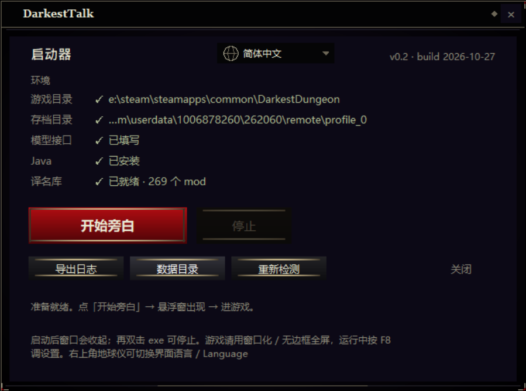
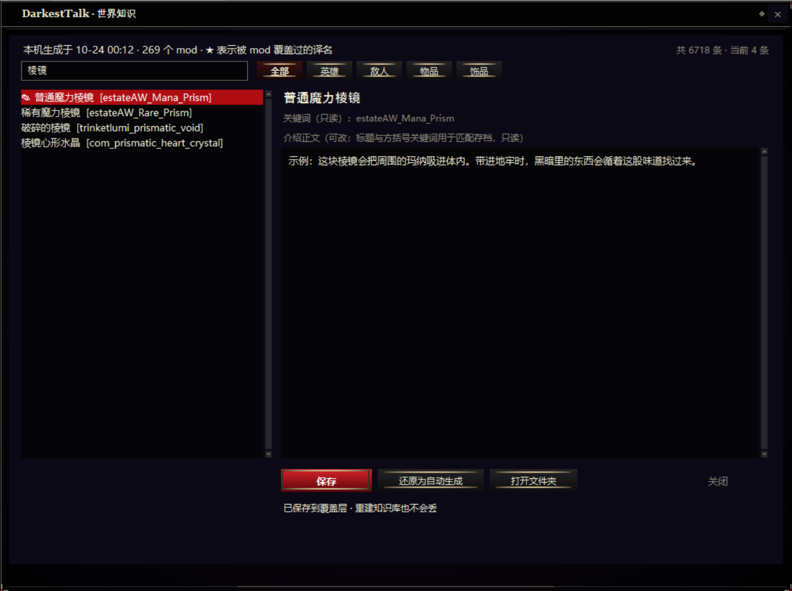

# DarkestTalk

在你打游戏时，从屏幕旁边给刚刚发生的那几秒钟配一句话。
不注入进程、不改存档、不改游戏文件——关掉就完全无痕。

<p align="center">
  
  
</p>

> 设计说明见 `v2_实时旁白设计说明.html`（含实测数据、三种场景切法、三段样章）。

## 目录

| 文件 | 作用 |
|---|---|
| `v2_实时旁白设计说明.html` | **先看这个。** 七条反馈怎么落地、数据能力边界、文风样章 |
| `dd_scribe.py` | 核心：读日志 → 切场景（战斗回合 / 地图区域 / 结算）→ 出事实卡 → 调模型 |
| `loc_index.py` | **离线**建映射包：只扫「当前启用」的 mod，产出一个可移植的 JSON |
| `overlay.py` | 置顶、点击穿透、可自由摆放的旁白窗 + 全部设置窗（tkinter，零依赖） |
| `theme.py` | **美术皮肤**：从游戏本体取的配色/金线/深红按钮，自绘按钮·滑条·面板·无边框外壳 |
| `overlay.json` | （在**数据目录**）覆盖窗位置/尺寸/字号/透明度/置顶 |
| `launcher.py` / `DarkestTalk.exe` | 启动器：环境自检 + 启动/停止 + 导出日志 |
| `launch.py` | 真正的启动器：解码存档 → 校验映射库 → 拉覆盖窗 → 跟随日志 |
| `paths.py` | 找游戏 / 存档 / mod / 工坊目录（环境变量 → paths.json → 自动探测） |
| `datadir.py` | **把玩家数据和代码分开**：一切可写文件都在 `<游戏目录>\DarkestTalkData\` |
| `i18n.py` + `lang/` | 界面多语言：`lang/` 下放一个 JSON 就多一种语言 |
| `housekeeping.py` | 启动时的收尾：日志轮转、超限文件滚动、清掉旧版本遗留 |
| `config.json` | （在**数据目录**）API key / 模型 / 温度 / 自定义提示词 |
| `tools/DDSaveEditor.jar` | 存档解码器（第三方，MIT）。存档是二进制，需它转明文。**不在本仓库**，见下 |
| `tools/names.txt` | 游戏+mod 的字符串哈希表（3046 条），用于解码存档里的哈希 id |
| `world/default/*` | （在**数据目录**）按本机 mod 生成的译名库、世界观设定 |
| `out/*` | （在**数据目录**）场景流、事实卡、live.txt、日志、debug.jsonl |

### 界面语言 / UI language

启动器右上角是语言开关：**地球仪图标 + 当前语言名 + 下拉箭头**。地球仪是跨文化的
「语言 / 地区」通用符号（Windows、macOS、iOS、Steam 都用它），不含任何文字，
不认识中文的玩家也能一眼认出这是换语言的地方；鼠标停上去会浮出 `Language · 语言` 提示。
切换后整个界面（启动器、悬浮窗、F8 设置台、世界知识、调试记录、路径窗口）立刻按新语言
重画。选择记在数据目录的 `ui.json`，下次启动沿用；从没选过时按系统语言走
（中文系统 → 简体中文，其余 → English）。

内置 `lang/zh_CN.json`（源语言）和 `lang/en_US.json`（231 条全量译文）。
**加一种语言不需要改代码**：复制 `en_US.json`，把 `_meta.code` / `_meta.native`
改成你的语言，逐条替换右边的文字（键是中文原文，不要动；`%s` / `%d` 占位符保留），
存成 UTF-8 放进 `lang/`，重启启动器就能在下拉框里看到。缺的键自动回落中文，
所以翻一半也能用。详见 `lang/README.txt`。

### 数据放在哪（重要）

**代码目录里没有任何玩家数据。** 一切可写的东西都在：

```
<暗黑地牢安装目录>\DarkestTalkData\
    config.json     接口 / api_key / 自定义提示词
    overlay.json    悬浮窗位置、透明度、字号
    world\default\  按你已启用的 mod 生成的译名库
    out\             日志、live.txt、debug.jsonl、导出的诊断包
    probe\           从存档解码出来的人物 / 战役数据
```

所以把整个工具文件夹压包发给别人，**不会**把 key、提示词、译名库、日志一起带出去。
反过来，换机器或备份时想保留设置，记得把这个目录一起带走。

找不到游戏目录时（还没装、装在认不出的位置），数据会退到
`%LOCALAPPDATA%\DarkestTalkData`，仍然在代码目录之外；一旦退过去就固定用它。

## 快速开始

**需要**：Windows、Python 3.8+（python.org 的标准安装包，带 tkinter）、Java 8+（给存档解码器用）。
游戏和存档位置一般不用填：`paths.py` 会自动找。找不到（或者想手动指定）就按 F8 →「路径…」。

1. 游戏改成**窗口化**或加启动项 `-borderless`（独占全屏会吞掉任何覆盖层）。
2. 双击 **`DarkestTalk.exe`** —— 打开启动器窗口：左边一列环境状态（游戏 / 存档 / 接口 /
   Java / 译名库），右下角「开始旁白」。第一次启动后按 F8 填 `api_key`
   （DeepSeek / 通义 / Kimi / OpenRouter 都行；本地 Ollama 填 `http://localhost:11434/v1`），
   点「保存并生效」。
3. 之后每次都是双击 `DarkestTalk.exe` →「开始旁白」。窗口会自己收起，工具在后台跑；
   想停止就再双击一次，它会认出"已经在运行"并给出「停止」。

第一次启动还会顺手做一件事：按**当前启用的 mod 列表**建一份知识库（1–3 秒）。
之后只有 mod 列表变了才会重建，不需要你手动跑任何东西。

启动器不绑死 Python 路径：依次找 `python_path.txt` → PATH →
`%LOCALAPPDATA%\Programs\Python\Python3*` → `%PROGRAMFILES%\Python3*` → 注册表 → `py.exe`。
**3.9–3.13 优先**（验证过的范围），机器上同时装了 3.14 也不会顺手挑最新的那个。
一个都找不到时，窗口里直接写清楚去哪儿装，而不是闪一下就没。

启动器实际做的事（和以前一样，只是入口换了）：

```
overlay.py --config overlay.json                              # 覆盖窗
dd_scribe.py --log <app.log> --roster probe/roster.json        # 解析
  --follow --decode-every 20 --salience 2.5 --window 2 --llm
```

> 没有 `run.bat` 了。真遇到杀软把 exe 拦了，在本目录执行 `python launcher.py` 效果一样。

### 从源码运行（本仓库）

仓库里是纯源码：不含编译好的 `DarkestTalk.exe`，也不含第三方存档解码器。

```bash
git clone https://github.com/Tubreva/DarkestTalk.git
cd DarkestTalk

# 把 DDSaveEditor.jar（第三方，MIT 许可）放进 tools/
#   没有它也能启动，只是读不到存档：队伍、阵亡名单、奇物互动会缺一块。

python launcher.py          # 和双击 exe 是同一个窗口；也可以双击 run.bat
python build_launcher.py    # 想自己打 exe，产物在 dist_exe/
```

玩家数据（`api_key`、译名库、日志）全部写在 `<游戏目录>\DarkestTalkData\`，
不在代码目录里，所以 clone 下来不会碰到别人的 key，也不会把自己的带上去。

## 只想看它抓到什么（不花一分钱）

```
python dd_scribe.py --log "<游戏目录>/app.log" --out out --salience 2.5
```

产物在 `out/`：`scenes_v2.jsonl` + `facts_v2.md`。用你现有日志实测：**82 个场景**（60 战斗回合 / 20 地图区域 / 2 结算）。

## 路径：游戏 / 存档 / mod / 工坊

工具不假设自己装在哪儿，也不假设游戏在哪个盘。四个目录各自独立地找，谁找不到就留空。

### 自动探测的顺序

```
① 环境变量   DD_GAME / DD_SAVE / DD_WORKSHOP / DD_MODS
② paths.json  {"game": "...", "save": "...", "workshop": "...", "mods": "..."}
③ 自动探测   ↓
```

| 目录 | 怎么找 | 命中判据 |
|---|---|---|
| 游戏 | 注册表 `SteamPath`/`InstallPath` → `libraryfolders.vdf` 里每个库（新旧两种写法都认）→ `steamapps\common` 下**按名字列一遍**（`Darkest Dungeon`、`… Build 25632` 这类重命名过的也认）→ 再扫 `Program Files`、`GOG Games`、`Games`、各盘根目录 | 里面有 `app.log` / `DarkestDungeon.exe` / `_windows` / `localization` |
| 存档 | 各 Steam 根的 `userdata\*\262060\remote\profile_*`（多账号、多档位都看，取最近玩过的）→ 再找 `文档\DarkestDungeon\profile_*`、`文档\My Games\...`、`%APPDATA%\DarkestDungeon`、游戏目录下 `profile_*` | 里面有 `persist.game.json` 或 `persist.roster.json` |
| 工坊 | 各 Steam 库的 `steamapps\workshop\content\262060` | 目录存在 |
| 本地 mod | `<游戏>\mods` | 目录存在 |

**名字只用来挑候选，能不能用一律看内容**：目录叫 `Darkest Dungeon - 副本` 但里面没有
`app.log`/`exe`，照样判为"不是游戏"，宁可留空也不猜。

反过来也能走：万一注册表里的 Steam 位置被改过、游戏没找到但**存档找到了**，会从
`userdata` 的上一层反推 Steam 根，再回去找 `steamapps\common`。

### 非 Steam 版

没有 `steamapps\userdata`、没有工坊目录，这两种情况都是**正常状态**，不是错误：

- 存档走 `文档\DarkestDungeon\profile_0` 这一类位置（上面那串候选里会命中一个）；
- 工坊那行留空，`loc_index.py` 只扫 `<游戏>\mods`；
- `manifest.json` 里的 `host` 判定、mod 指纹都照常工作，只是"Steam mod 数"恒为 0。

找不到游戏目录时会弹一个系统对话框，直接把该往 `paths.json` 里写什么告诉玩家，
而不是静默失败（`pythonw` 下没有控制台，静默失败等于没反应）。

### 手动指定：F8 →「路径…」

```
游戏目录   [<你的 Steam>//steamapps//common//DarkestDungeon      ] [浏览…]   ✓
存档目录   [<你的 Steam>//userdata//<数字ID>//262060//remote//profile_0] [浏览…]   ✓
创意工坊   [<你的 Steam>//steamapps//workshop//content//262060   ] [浏览…]
本地 mod   [<你的 Steam>//steamapps//common//DarkestDungeon//mods] [浏览…]
                                     [自动检测] [保存] [关闭]
已保存到 paths.json · 重启工具后生效
```

- **自动检测**：重新跑一遍探测，把命中的结果填进四个框（可以当"查看当前用了什么"）。
- 手填的目录会立刻做一次校验：游戏看有没有 `app.log`/`exe`，存档看有没有 `persist.game.json`，
  不对就标 ✗，并提示"是不是选到了上一级"。
- 保存写进**数据目录**的 `paths.json`，重启工具后生效。空着的行不会写入——
  也就是"这一项继续自动找"。

```json
{
  "game": "D:////Games////DarkestDungeon",
  "save": "C:////Users////me////Documents////DarkestDungeon////profile_0"
}
```

### 这和"把工具放进 mods 目录"有什么关系

没有任何关系，这是把它做成可分发版本的前提：四个路径全部绝对化、可覆盖，
所以工具放在 `E://Steam//steamapps//common//DarkestDungeon//mods//DarkestTalk//`
和放在 `D://Tools//DarkestTalk//` 完全等价。建库时 `loc_index.py` 也接受
`--mods-dir` / `--workshop`，不再靠 `..\..\workshop` 这种相对推断了
（非 Steam 版那条相对路径本来就不成立）。

## 本地化 / 知识库：什么时候建、什么时候重建

界面上的文字全部存在 `.string_table.xml` 里，内部代码（`str_quirk_name_bad_gambler`）
要先查表才知道中文。构建产物都在 `world/default/`：

| 文件 | 内容 | 谁用 |
|---|---|---|
| `loc_zh.json` | id → 中文（68480 条） | 运行时查名字（**毫秒级读这一个文件**） |
| `trinkets.json` | 饰品词条 | 相关背景 |
| `heroes.json` | 职业名 + 三段界面介绍 | 队伍档案（每次调用） |
| `monsters.json` | 敌人名 + 招式名 | 战斗第一场旁白 |
| `knowledge/*.md` | 给人看的速查表 | 世界知识窗口 |
| `manifest.json` | 指纹、host、mod 数 | 判断能不能用 |

**不是每次都建。** 启动时 `launch.py` 先解码存档取当前启用的 mod 列表，再和
`manifest.json` 比，只有下面几种情况才重建（约 1–3 秒）：

| 情况 | 结果 |
|---|---|
| 没有 `manifest.json` | 必建（第一次运行） |
| `host` 不是本机 | 必建 —— **别人机器上生成的库一律不认** |
| mod 指纹变了 | 必建（加/减/换 mod） |
| 当前没启用任何 mod，库里却记着有 | 必建为原版（否则会读到残留的 mod 译名） |
| 没有存档、读不到列表 | 不建，沿用本机旧库（避免每次启动白扫一遍） |

`host` 是 `游戏目录 + 计算机名 + 用户名` 的哈希。它解决的就是「别人拿到我的包」：

```
我这台:  host=c86f6b79205b  →  268 个 mod 的译名表
他下载:  host 对不上         →  丢弃，用他自己的 mod 列表重建
```

**分享工具文件夹时不用管这些生成物**：它们现在都在数据目录里，不在工具文件夹内（`loc_zh.json`、`heroes.json`、
`monsters.json`、`knowledge/` 都是按当前 mod 列表算出来的）。对方第一次启动时会自己建一份。
等测试稳定、真要发出去的时候再写打包脚本——现在就固定目录结构，改起来不方便。

F8 →「④ 知识库」会显示 `268 个 mod · 建于 …` 和当前是否一致，
右边有「重建知识库」按钮，改完 mod 不想重启也能点。

**中文路径的坑（已修）**：`DDSaveEditor.jar` 是 Java 8 编的，命令行参数里的非 ASCII
路径会被按 ANSI 解码成乱码，报 `Could not read .../暗黑地牢AI...`。
现在所有解码都走 `savedec.py`：路径含中文时先把存档复制到 `%ProgramData%\dd_narrator_tmp`
（纯 ASCII），java 在那里解码，再复制回来。工具装在中文目录、Windows 用户名是中文都能跑。

**路径不写死**：`paths.py` 按 环境变量 `DD_GAME`/`DD_SAVE` → `paths.json` →
注册表里的 Steam 路径 + `libraryfolders.vdf` 的所有库目录 → 找 `app.log`，
存档则取 `userdata/*/262060/remote/profile_0` 里最新的那个。找不到会弹窗告诉你怎么办。

## 世界知识

建映射包时会顺手生成 `world/default/knowledge/`：

| 文件 | 内容 |
|---|---|
| `heroes.md` | 88 个英雄职业 + 公会/铁匠铺/营地三段原文 |
| `monsters.md` | 1113 种敌人 + 它们的招式 |
| `items.md` | 3633 条物品名 + 完整描述 |
| `trinkets.md` | 1831 个饰品名 + 可还原的效果 |

只有这四份。**怪癖、奇物、城镇事件不再进知识库**：

- 怪癖（含疾病/折磨）直接进 prompt 的人物状态，全量、不截断——见下一节；
- 奇物互动要的是「谁碰了哪一个、得到什么结果」，等专门处理，不需要一份名字清单；
- 城镇事件本来就能从 `persist.campaign_log.json` 直接读到，不需要走「知识库 + 匹配」。

物品与饰品的名字、描述、效果在建库时都会过一遍 `clean_text()`：
`{colour_start|starnight3}`、`{colour_end}`、`{?cond}`、`¤` 全部去掉。

- **★ 标记 = 同一个 id 有多个译名**，通常就是你装的 mod 覆盖过的（例如 `祖母绿震动棒 [gememerald] ★`）。
- 名字解析顺序：`overrides.json`（你手改的）→ 日志里真实出现过的 → **最后加载的那个 mod 的译名**。
- **改介绍**：F8 →「世界知识」，左边逐条列出（有搜索框与分类筛选，右侧有滚动条），
  点一条就在右边改它的介绍正文；标题和方括号里的关键词用于匹配存档，只读。
  改动单独存在 `knowledge_overrides.json`（覆盖层），重建知识库、换 mod 都不会丢，
  点「还原为自动生成」即可撤销。
- 改名字仍走 `overrides.json`（键 = id，值可只写 `name`），改完重启工具生效。
- 物品描述现在会随拾取一起进事实卡，例如 `祖母绿震动棒（绿色如熔化的嫉妒。）`——模型看到的是玩家看到的东西。

## 饰品（这块之前是漏的）

存档里每名英雄有 `trinkets` 字段，之前完全没读。现在读进来，并且**效果不是硬编码**：

- 名字：`str_inventory_title_trinket<id>`（mod）/ `str_inventory_title_<id>`（本体），两种都试。
- 效果：`shared/buffs/*.json` 里 buff 的 `stat_type` + `stat_sub_type` + `amount`，
  配上本地化模板 `buff_stat_tooltip_<stat_type>[_<sub_type>]`，格式化就是游戏 tooltip 那几行。
  模板缺失的 buff **直接丢掉**，不会出现 `?xxx` 或原始 id。

实测与游戏一致（蹒跚者之冠 = +15精准 / +5%暴击 / +10%最大生命 / -33%疾病抗性）。

进 prompt 的位置分两层：

```
· 状态｜赤羽隼人（星火·灾星）：佩饰 封邪黄符、蹒跚者之冠；怪癖：敏感阴蒂、捕蛛达人
```

```
【相关背景｜只用来理解这些人是什么状态，不要在正文里解释或复述】
饰品「蹒跚者之冠」：+15精准、+5%暴击、+10%最大生命、-33%疾病抗性
```

**只在战斗第一回合报一次**——饰品是静态装备，每回合重复只是白烧 token。

开关：`config.json` 的 `trinket_effects_on`（false = 连饰品名都不发）；设置台里一键开关。
**数值词条不进 prompt**：`+15精准`、`-33%疾病抗性` 这类会被换成「只给名字」，
因为硬约束里写着不复述统计。纯叙事型词条（`超体与繁开的觉醒`）照旧保留。
世界知识里多了 `trinkets.md` 可以翻。

## 事实卡长什么样

每一张卡只讲**刚刚发生的这一拍**，按固定顺序铺开：地点与任务 → 场上站位 → 谁做了什么 → 这一拍里的瞬时事件。

```
【战斗 · 第16–17回合 · 荒野 · 清剿】
此刻在：走廊
我方站位（1 号位在最前）：1 号位 雨宫优子、2 号位 莉法、3 号位 羽丘源、4 号位 兰博库尔
敌方站位（1 号位在最前）：1 号位 桎梏巨人、3 号位 亡命射精狂
地上的尸体（占着格子、挡走位，不是活敌）：3 号位 满足的生物
（站位表是从画面读到的；这一拍真正出手的敌人以「敌方出手」为准…）
（这一拍，只写这些）
我方出手：
· 莉法：命中 2/2，打向 2 个目标，其中一记是重手，放倒 1 个
· 羽丘源：治疗同伴 1 次（日志不记治的是谁）
敌方出手（敌人彼此不是同伴…）：
· 桎梏巨人：命中 1/1
这一拍里发生的事（只在这一拍有效，下一拍不再提）：
· 莉法 濒死
· 雨宫优子 精神崩溃（星界调和）
```

规则：

- **地点与任务**：进副本那一刻从任务语音里读出来（`/vo/neutral/weald_cleanse` → 荒野 · 清剿），
  中途每张卡都带同一份，不会出现"在兽窟里被告知这是荒野"。
- **站位**：日志的 `RERANK-POS` 给了每个单位的 `pos`（1 最前），我方与敌方各自从 1 数；
  尸体也是真实单位，单列一行并注明"不是活敌"。战场一换，上一场的站位立刻清空。
- **出手**：日志只给命中判定次数，判定 N 次表示**一次攻击波及 N 个目标**，不是挥了 N 刀。
  暴击、放倒几个、治疗几次都记在这一行。治疗对象日志里没有，所以只写"治疗同伴 N 次"。
- **瞬时事件**（濒死 / 精神崩溃 / 显现美德 / 阵亡）：只在发生的那一拍出现，
  报过就记在 `_seen_effects` 里，之后不再重复；阵亡更是独立一张卡，报完把人从队伍里摘掉。
- **去掉的**：走过几格、原始区域 id（`coGH` 这种对模型毫无意义的内部名）。

### 奇物互动

日志里**没有**"谁动了哪个奇物"这种行，所以要三份存档合起来还原：

| 文件 | 提供什么 |
|---|---|
| `persist.curio_tracker.json` | 每次互动的结果类别：`loot` / `buff` / `heal_gen` / `heal_stress` / `purge_neg` / `summon` |
| `persist.map.json` | 每个区域每一格放着什么奇物（`###stack_of_books`），以及区域总格数 |
| `persist.raid.json` | 当前在该区域的第几格（`areatile` 是"走了几步"） |

奇物名与那句 flavor text 走本地化：`str_curio_title_<id>` / `str_curio_content_<id>`。

**位置怎么定：** 日志的 `move to area 'coRS', tile 6` 给出进入格，`raid.json` 的 `areatile`
给出走了几步；走廊是线性的，方向靠"进入格旁边有没有格子"判断（入口在 0 只能往大走，
在末格只能往小走），于是当前格 = 进入格 ± 步数。

**谁动的手：** 互动只会落在一个人身上，所以比较互动前后的人物存档
（血量 / 压力 / 怪癖），谁变了就是谁。拿不到就写"不明"，绝不指名。

产出长这样：

```
【奇物互动 · 走廊 · 遗迹 · 采集遗物】
动的东西：一摞书籍——一摞情色读物竟出现在这种地方，实在透着几分古怪。
结果：拿到了东西
动手的人：御影（压力-12，新增怪癖：风湿病）
这是路上的一次停顿，不是战斗，也不是拾取。（没有敌人，不要写交手；下一拍不会再提这件事）
```

**只报一次**：判断"是不是新的一次互动"用的是记录的**内容签名**
（`prop_name_id` + `item_type_hash` + `item_id_hash` + 结果类别），不是第几条。

⚠️ `tracked_results` 不是按时间追加的日志，而是一张按 (奇物, 用品) **排序的表**：
下标 0..N 是按 `prop_name_id` 升序排的，中间插进一条，后面所有下标整体后移。
早先版本用「条数/下标」做差（`order[last_count:]`），结果每存一次档就把一串
很早以前的老记录当成新事件重播一遍——表现就是同一件事被没完没了地播。
现在跟顺序彻底无关：签名没见过才算新。

⚠️ **一次互动可能被游戏记成好几行**（实测一次「麻袋」写进 3 行：不同用品、不同结果，
分两次存档落盘）。所以读到新行后不立刻出卡，而是等 3.5 秒没有新行，再把这一批
**合并成一张**（优先用地图上认得出名字的那行）。日志里会看到
`[奇物] 3 条记录是同一次互动，合并成一张卡`。

**开销：** 只 `stat` 一下 `curio_tracker` 的修改时间，变了才解码（三份存档各约 0.4 秒）。
不做轮询式扫盘。开关 `curio_on`，F8 里能关。

### 回到城镇（城镇日志）

小队外出期间镇上发生的事，在 `town_visit_start` 时单独出一个场景：

```
【回到城镇 · 20:41:08】
小队离开的这一周，镇上发生了这些：
· 赤羽隼人、御影、邦德维尔、瑟纳蓬携带春药遗物从遗迹归来！(学徒 中)
· 镇上传开一件事：狂欢匠节
他们刚回来，可以有人开口、有人不说话。
```

**一章 = 一周。** 归来记录、这一周的城镇活动（疗养院、升级、建筑）、城镇事件，
全部写在**同一个章节**里：

```
章节 12
 ├ 0  归来的那趟（success / start=False / 队伍 / 阵亡）
 ├ 2  城镇事件 rtti 844919810 → ###free_abbey → 狂欢匠节
 └ …  英雄升级、建筑活动、建筑升级、地牢解锁
```

所以回城时不需要"往后找一章"，直接用**最后一个有归来记录的章节**。

两条硬要求：

- **必须读实时存档**。以前 `Campaign` 读的是 `probe/campaign_log_named.json`——一份
  上一次手动解码留下的静态文件。于是你第 11 周回城，看到的却是第 6 周的日志。
  现在跟随模式下 `Campaign.refresh()` 每次现解码 `persist.campaign_log.json`（3 秒节流），
  结算那一刻强制刷新一次。
- **城镇事件也从这一章取**（`rtti 844919810`），不再读 `persist.town_event.json`。
  那个文件会停在旧值上，正是"在地下墓穴繁殖"串到你这一周的原因。

「归来」那句话直接用游戏自己的文案，不自己拼：

```
str_returned_from_<任务>_<地牢>_<success|failure>
  → {?hero_names}%s携带春药遗物从遗迹归来！（{?difficulty}%s {?length}%s）
  → 赤羽隼人、御影、邦德维尔、瑟纳蓬携带春药遗物从遗迹归来！(学徒 中)
```

任务名有个坑：存档里的 `difficulty` 从 0 起，键名从 1 起。所以两档都试；
**同类型任务在同一地牢里有多个变体时只报类型**（采集遗物 / 探索 / 清剿 / 讨伐首领），
不猜具体任务名——猜错比模糊更糟。

解析的记录类型：

| 记录 | 含义 |
|---|---|
| `rtti 2006063882` | 一趟任务的记录（`start=True` 出发 / `False` 归来，带 `success`） |
| `rtti 844919810` | 城镇事件结果 |
| `rtti -317933210` | 英雄在建筑里的活动（治疗 → **移除**怪癖/疾病） |
| `rtti -579125384` | 英雄升级 |
| `rtti -37270005` | 建筑升级 |
| `rtti 1114009654` | 地牢解锁 |

### 关卡结算

三个界面（战果 / 带回物品 / 城镇事件）合并成一次输出：

```
【任务结束 · 荒野 · 清剿】
地牢难度等级：老练，地牢尺寸：中
结果：任务完成，但是 莉法 死亡
回来的人：兰博库尔、羽丘源、雨宫优子
带回：金币×39、地契×13、星晶碎片×13……
新增怪癖：羽丘源—直面灾厄·绽放、雨宫优子—好感度40%，另有 1 项
小镇事件：本趟没有触发
```

难度与尺寸**单独成句、并且把字段名写出来**（`地牢难度等级：老练，地牢尺寸：中`）——
只写"老练 · 中"模型只能猜这两个词各是什么，容易当成场面形容词塞进正文。这两项只在
「出发」和「任务结束」出现，每回合的战斗卡不挂，免得啰嗦。

**三件事不受「每隔几回合」约束，一定会单独出一拍**（`emit_every` 只管战斗回合）：

| 时机 | 来源 | 没有对应日志时怎么办 |
|---|---|---|
| 关卡开始 | `quest_start` | 刚从镇上踏进地牢（第一次出现房间/走廊）就补一张「出发」 |
| 关卡结束 | `quest_end_completed` | 回到城镇（`town_visit_start`）时如果这一趟还没结算，就补一张「任务结束」；不知道该算成功还是逃跑时写"任务结束"而不是"任务完成" |
| 一场战斗结束 | `victory` | `close_round(force=True)`：把还没播过的回合补一张，奇数回合打赢也不会被丢掉 |

顺序上，结算一定排在「回到城镇」**前面**，回城时也会先把没关掉的房间/战斗收掉，
所以不会再出现"上一趟的结算/路上"排到回城之后、甚至下一趟出发之后。

**结果这一句把"有几个人没回来"直接写死**，不留空让模型自己编：

| 成败 | 有没有人死亡 | 输出 |
|---|---|---|
| 完成 | 没有 | `任务完成，无人死亡` |
| 完成 | 有 | `任务完成，但是 莉法 死亡` |
| 没完成 | 没有 | `任务未完成，无人死亡` |
| 没完成 | 有 | `任务未完成，死亡 莉法、雨宫优子` |

数据来源：
- **战果/任务**：`campaign_log`（地点、难度、长度、成败）
- **带回物资**：本趟日志里的 `Loot: Rolled` 聚合，名字走 mod 译名
- **怪癖 / 疾病**：出发时的名册快照 vs 结算时的名册，只算**本趟队伍**
  - 疾病靠 `shared/quirk/quirk_library.json` 的 `is_disease` 区分（当前 48 条）
- **小镇事件**：`persist.town_event.json` 的 `current_result_event_id` → `town_event_title_*` / `town_event_description_*`

**为什么不会拿上一趟的战果充数**：存档里每一趟会留两条记录——
出发时那条 `start: true`，**下周**才写结果那条 `start: false`。所以：

- 这一趟打的是什么，读 `start: true`（或出发语音），绝不读"最后一条结果"；
- 结算时想用结果记录里的难度/阵亡名单，必须**地牢、任务、人**三样都对得上，对不上就丢弃；
- 回城那句"谁回来了"同样只认这一趟的记录，存档还没写就用日志+名册自己拼一句。

以前直接取 `latest_quest()`（最后一条结果），在副本中途或刚结算时正是**上一趟**的记录，
于是会出现"这趟在兽窟，旁白却说荒野"、"上周死的人算到这周头上"。

**副本状态会落盘**（`out/raid_state.json`）：中途重启工具后 也能接上这一趟，
不会因为没看到 `quest_start` 而丢掉战利品和出发档案。结算完自动删除。

### 扎营

日志里只有一行 `Narration: entry type: camp`，**不记录用了哪些扎营技能、吃了什么、谁说了话**。
所以扎营场景靠「存档前后对比」还原：

```
【扎营 · 18:10:02 到 18:15:22】
休整结果：邦德维尔 压力-61（现11）、血量+17.7（现29.7）；御影 压力-42（现6）、血量+16.7
说明：日志不记录用了哪些扎营技能，只知道他们停下来休整过。
```

- 扎营开始时**强制解码一次存档**作为"前"，结束（重新走动 / 进战斗 / 结算）时再解一次作为"后"。
- 结束事件抓不到时，用日志最后时间兜底。
- 血量/压力是副本内的实时值（`persist.roster.json` 每回合都会写），不是回城后的快照。

### 为什么事实卡里没有「这一回合用了什么技能」

翻遍 `app.log`：每次行动只有 `bs_turn_do_skill` 状态跳转 + 若干组
`Chance to hit / Roll to hit`，**没有任何一行记录用了哪个技能**。
`combat_skill_id` 只出现在 mod 的 JSON 解析报错里，不是行动日志。
所以「这一回合的技能名」一律不写——宁可缺，也不让模型猜出「他使出了融化命运」这种没发生的事。

但**「这个敌人会什么」是拿得到的**：`monsters/<id>/<id>.info.darkest` 里写着它带哪些
`skill: .id "…"`，本地化里有 `str_monster_skill_<id>` 给出中文名。这构成了下面的敌人知识库。

## 知识怎么选、怎么发

`knowledge/` 里那几十万字**从不整体发送**。运行时按「会不会变」分三层：

| 层 | 内容 | 放在哪 | 频率 |
|---|---|---|---|
| ① 队伍档案 | 名字、**职业介绍**、有含义的怪癖、疾病、饰品名 | user 段，事实之后 | 每次调用都带最新的 |
| ② 对手的手段 | 「这场敌人会什么」 | 事实卡里，对手列表下面 | **每场战斗只报一次** |
| ③ 当下状态 | 折磨/美德、压力告急 | 事实卡尾部 | 每场 |
| ④ 名字查表 | 6.8 万条 id→中文 | 不发送，只用来替换 | 每次 |

### 为什么队伍档案不放 system

问得对：system 里塞的东西越多，模型对每一条的注意力就越淡。所以现在的分工是——

```
system   文风、世界设定（玩家写的）、硬约束   ← 稳定，一局里不变
user     这一场的事实、队伍档案、当下状态     ← 每次都是最新的
```

两个具体理由：

- **队伍档案会变**。换装、染病、治愈、改名字，任何一项都让档案变一次。
  如果它在 system 里，指令块就跟着整段变——模型每次都要重新"读一遍规矩"。
- **玩家的雇佣兵会到 30–50 人**，但一次只上场 4 个。发的是**上场的人**，
  人数多少不影响长度。
- **不做字数截断**。一局地牢很长，队伍状态在大多数回合里不变，真正每回合变的是事实卡；
  把四个人的来路写全（职业介绍原文 + 全部怪癖 + 疾病 + 装备），比每次省两三百字更有价值。

### ① 队伍档案：三类数据，三种更新方式

| 数据 | 会不会变 | 怎么处理 |
|---|---|---|
| 职业 | **永远不变** | 用它去查**游戏自带的职业介绍**（见下），不自己编 |
| 名字 | 游戏内可改 | 每次现取 |
| 饰品 / 怪癖 / 疾病 | 会变（换装、获得、治愈） | 每次现取 |

队伍是**从存档补出来的**，不依赖日志里出现 `quest_start`。工具若在一趟副本中途启动
（比如你重开工具），日志里没有出发事件，以前 `heroes_in_raid` 会是空的——
prompt 里就只剩位置和事件，一个人名都没有。现在启动时先读 `persist.raid.json` 的
`party.heroes`（guid 列表），再按 guid 去名册查职业；读不到才退到战役日志里
**地牢和任务都对得上**的那条出发记录。raid 存档超过 12 小时没动过的视为上一趟留下的，
不用它；刚进副本那一刻还会要求它的修改时间不早于出发时刻，避免拿到上一趟的文件。

**档案里只会有这一趟真上场的人**（2026-10-21 修）。以前只做加法：出发时补一批、
战斗中 `RERANK` 再往里加，两头来源不一致就会混进上一局的人（连已经阵亡的都还在）。
现在两道闸：

- **出发时**只认 `raid.json`（这一趟的游戏存档）或"地牢 + 任务都对得上"的出发记录，
  对不上就空着，等第一场战斗；
- **第一场战斗开始**时攒这一场的 `RERANK` 全场刷新——游戏自己列出的"此刻在场的单位"
  就是这一趟真正带出来的人。第一个回合结束前用这份名单**整体替换**队伍档案，
  上一趟留下的名字全部清掉；已阵亡的 guid 不会被补回来。

队伍上限按四人处理（暗黑地牢一队就是 1–4 人），多出来的按"最后出场"的顺序裁掉。

出发时的来源顺序：`persist.raid.json` → 名册里 `roster.status = 1`（正在出击）→
刚进副本那一刻的 `last_party` → 战役日志里"正在打的那趟"的队员。**阵亡者（status 3）
在任何一步都会被跳过**，所以死人不会混进档案。

关键是**不留进场快照**。以前的实现把队员的存档对象在进场时存进 `heroes_in_raid`，
而名册每次刷新都会重建一批新对象——存下来的那份就永远停在进门那一刻，
中途换装、染病都不会反映。现在只存 guid，读的时候按 guid 现查名册：

```python
h = self.roster.heroes.get(guid)      # 每次都是最新的
```

产出长这样：

```
【这一趟的同伴（背景资料，不是指令；没被提到就别主动介绍。
  「健康状态 / 随身装备」只是角色身上的东西，不是敌人、不是事件）】
御影：狼女可谓是百战余生，艰苦的时光使她成为了完美的捕食者。她制定了自己的战术，总能抓住时机重创敌人.
  ｜健康状态：患病「漆黑触手」｜怪癖：淫纹：色欲「她的脑袋里只剩下涩涩~」、信徒、机巧恋物癖、嗜爱寒冷、
  海湾肉便器、顺从之心「极度渴望…」、盛绽之花、王牌骑乘位「…」、浑然天成、色欲之眼、坚毅决心、好感度100% …
  ｜随身装备：薄荷冰淇凌
塞利西亚：玉藻巫女已经反省了过去的恶行，自断尾巴，跌落到一尾的状态……她现将自己的魔力凝聚成了治疗技能、
  神圣祷言和耀眼爆发的咒术干扰。玉藻巫女是任何队伍的强力后援，请务必保护好她。
  ｜怪癖：信徒、精液成瘾「疯狂执迷于吞咽和饮用精液。」、昂首阔步、静伏之种、小姓寄生 …
```

三条规则：

- **怪癖全收**。哪怕本地化里没有描述也收名字——「风湿病」「信徒」「精液成瘾」这些
  名字本身就有信息量。以前按“有没有描述”筛掉一批，等于把最直白的线索也筛掉了。
- **只有纯数值描述不带**（`+15精准`、`-33%疾病抗性`）。它会让模型写成战报，
  和「不复述统计」的硬约束打架；名字照留。
- **带归属**。「淫纹：色欲」孤零零一行时，模型不知道是谁的；现在跟在人名后面。

### 英雄知识库：介绍从哪儿来

以前"职业"那一栏是拿 `hero_class_name_` 反推的，于是两头都不对：

- **怪物混进来了**。`skeleton_maid`、`skeleton_defender` 这类敌人也有 `hero_class_name_`，
  于是它们被当成"职业"，还列出技能名；
- **技能名对写作没有用**。`净化、传染祭品、毒性破坏…` 只是招式列表，模型看了也不知道
  这个职业在队伍里干什么。

现在改成两条正路：

```
职业名单   heroes/<cls>/<cls>.info.darkest 存在 → 才是可招募职业（本机 88 个）
职业介绍   action_verbose_body_guild_<cls>            公会：战斗定位
           action_verbose_body_blacksmith_<cls>       铁匠铺：武器与护甲
           action_verbose_body_camping_trainer_<cls>  营地：营火边的行为
```

这三段正是游戏里在对应建筑中显示的那段原文，不带任何我们的加工。运行时：

- **平时（战斗、走廊、奇物）用公会那段**——说的是这个职业怎么打、靠什么活；
- **扎营用营地那段**——说的是他在火堆边干什么；
- 公会缺失才退到营地/铁匠铺；三段都没有就只写名字。
- **原文整段发送，不截断**。介绍长的职业有 260 字（个别还夹着玩法说明），
  但这属于“这个人是谁”的一部分；一局里它不变，按你的判断，缓存命中的情况下不值得为它省字。

> 名字走中文表，只有英文表的 mod（例如某些韩文/英文作者的作品）自动用英文原文——
> 总比显示 `murphy` 这种内部 id 强。

### 敌人知识库：只有招式名

敌人没有介绍文本可抓。能拿到的只有 `monsters/<id>/<id>.info.darkest` 里的
`skill: .id "…"`，加上本地化的 `str_monster_skill_<id>`。所以敌人库就是：

```
白骨弩手：争端弩箭、坚挺突刺、标记射击、亡者复仇
猪束缚者：后庭钩刺、溃逃、退缩
```

用法有严格限制——**每场战斗只报一次**，而且写在事实卡里、紧跟对手列表：

```
当前的对手：白骨弩手、猪束缚者
（这一回合只有这些对手；不要加入清单外的敌人）
这些对手的手段（仅仅是它们会什么，不代表这一回合用了）：白骨弩手（争端弩箭、坚挺突刺…）
```

「这一回合用了什么」日志不记录（见上一节），所以措辞必须把这点说死，否则模型会把
"它会标记射击"写成"它刚刚标记射击了"。实测两句都自然用到了招式名：

> 猪束缚者没有退，后庭钩刺带着一股腥臭的弧线甩过来，钩尖擦着塞利西亚的衣角撕开一道口子。

> 它抬起弩臂，指节咔嗒作响，一箭破空而来，钉在塞利西亚脚边的石砖上。

### 变化本身也是一条信息

接口是无状态的：每次调用，模型都从零看一遍 system 和这一条 user。
所以"完整状态"必须每次发全（不能只发增量），但"刚刚发生了什么"只有对比才看得出来。
两者都发：

```
【这一趟里刚发生的变化（可以作为动作写进去）】
· 御影：摘下 薄荷冰淇凌；换上 蹒跚之冠
· 塞利西亚：染上「畸形孕体」
· 白狼（原 御影）：改了名字
```

这一条只出现一次（取走就清空），并且同一趟最多带 8 条。
日志里也会打 `[队伍] …`，方便你对照游戏里是不是真发生了这件事。

> 实测过四种情况：原地换装、名册整体替换（模拟 reload）、改名、疾病染上再治愈。
> 四种都能当场反映到档案里，并各自产生一条变化。

### ② 每场只补"当下"

事实卡里的静态信息不再重复：`我方：赤羽隼人、御影、塞利西亚、邦德维尔`（不带职业），
状态行只留「已陷入享乐主义；压力119」。怪癖和饰品不在每场出现。

### 世界设定：全部由玩家写，我们不做预设

- 内置提示词里**没有任何具体世界**：没有地名、势力、历史、信仰。只说一句
  「设定以游戏本身和玩家写下的为准，没有的一律不编」。
- `world_bible.md` 与世界观编辑器的模板从「（例）某某是某职业」改成了空白说明，
  一个示例人物都不给。
- 世界观注入时的标题也从「世界观补充」改成「世界设定（玩家提供，优先级最高）」，
  位置仍在 system 末尾，方便覆盖我们的默认。

按队伍裁剪的规则保留：提到当前队员（名字或职业）→ 留；提到名册里没上场的人 → 丢；
谁都没提（世界、地牢、规矩）→ 留。实测 171 字筛到 73 字，一段都没命中就退回全文。

> 已知限制：名册里存英文原名（`Dismas`）而你写中文译名（迪斯马）时匹配不上，
> 那一段会被保留。多发一点，不会丢东西。

### 三个会诱发幻觉的地方（已改）

这一版出过一次很典型的幻觉：走廊里没有敌人，模型却写出「几只哥布林从拐角挤出」，
然后顺着这段自己编的战斗连续写了很多回合。三个诱因，分别堵掉：

| 原来 | 问题 | 现在 |
|---|---|---|
| `病：哥布林族、拟态者卵` | 读起来像"正在和哥布林打交道"，走廊里就凭空开打 | `健康状态：患病「哥布林族」「拟态者卵」`，并在档案标题里注明"不是敌人、不是事件" |
| `对面（此刻还活着的）：` | 措辞像在描述战况，走廊场景里没有这句时会让人脑补对手 | `当前的对手：`；有对手时补一句"这一回合只有这些对手"；没有时写"无（这一回合没有可交手的对象）" |
| `上一段旁白（不要重复…）` | 只说了别重复，没说它不是事实；上文留了个"前面有东西"的悬念，模型就接着写下去。而且模型本来就能从对话里看到自己写过什么，这一段是重复投喂 | **整段删掉**，不再发送（也没有用别的句子替代） |

另外给非战斗场景加了硬指针：

```
【走廊 coCD】
走过 6 格
同行：赤羽隼人、御影、塞利西亚、邦德维尔
（路上没有触发战斗：不要出现敌人，也不要写交手）
```

用同一段上文、同一个走廊场景复跑，输出变成"压着肩贴墙、看着那抹暗红滑过去、
决定不理它"——有反应、有走位，但没有敌人，也没有编战斗。

### 内容尺度

工具**不过滤题材**。mod 里的露骨文本、成人向设定，只要在本地化或存档里，
就按原样进入 prompt；写不写、写多直白，由你选的模型服务端决定。
我们只做两种与题材无关的裁剪：

- **纯数值词条**（`+15精准`、`-33%疾病抗性`）不进 prompt——它会让模型写成战报，
  和「不复述统计」的硬约束直接打架。
- **不做字数上限**。人物介绍、怪癖、装备都按原样发全；只有纯数值词条被滤掉。

### 实测

同一个战斗场景（四人队，round 2）：

| | system | user | 合计 |
|---|---|---|---|
| 旧（每场挤 400 字预算，档案在 system） | 1694 | 202 | 1896 |
| 新（档案进 user，字段更全） | 1507 | 562 | 2069 |

user 段变长是故意的：档案从「只给名字」升级成「名字+职业+有关联的怪癖描述」，
system 则回到 1507（玩家的自定义文风），不再随装备变化抖动。

> 以前的 400 字预算还有个隐患：它是**全队共用**的，四个人的怪癖加饰品一旦超了，
> 排在后面的人直接被截掉，而且没有任何提示。现在按人分配，超了只截这个人自己的。

开关：`knowledge_on`（关掉就只剩事实卡）、`party_pack_on`、
`bible_filter_on`、`bible_budget`。F8 第一个开关就是 `knowledge_on`。

## 覆盖窗操作

| 按键 | 作用 |
|---|---|
| **F8** | 打开设置台；其余功能都在里面用按钮点 |
| **右侧控制栏 ×** | **退出整个工具**（旁白窗、解析器一起退出）。会跟着文字透明度变淡 |
| **右侧控制栏 完成 / 拖动 / 缩放** | 点 F8 →「编辑窗口」后展开：结束编辑 / 移动窗口 / 改大小 |

设置台底部的按钮：

| 按钮 | 作用 |
|---|---|
| 保存并生效 | 写入 config.json，主程序 1–2 秒内自动重载 |
| 恢复默认 | 把开关和节奏复位（不动你的 key 和提示词） |
| 提示词 | 三段提示词一页：世界观、文风、角色状态（含同伴/怪癖/装备的说明文字） |
| 世界知识 | 逐条浏览 / 编辑由 mod 本地化生成的知识条目（介绍可改，标题与关键词只读） |
| 调试记录 | 最近几次完整 prompt：折叠只看输出，展开看 system + 输入 + 输出 |
| 编辑窗口 | 覆盖窗右侧展开控制栏（完成 / 拖动 / 缩放），调完点「完成」收起（只关设置窗，不动文字层） |
| 关闭 | 关掉设置台 |

每个设置页**只会开一个窗口**：F8、提示词、世界知识、调试记录、路径都算独立的一页，
已经开着的时候再点一次，是把那个窗口抬到最前，而不是再开一个副本。
（以前能连点出三四个「设置」互相压着，各自的副本还会在保存时互相覆盖。）

### 右侧控制栏：× / 完成 / 拖动 / 缩放

旁白框右边缘贴着一枚深底金框的小方钮 **×**，点它退出整个工具；
点 F8 →「编辑窗口」，这枚小钮会向下展开成一条竖排控制栏，从上到下四项：

| 位置 | 文字 | 干什么 |
|---|---|---|
| ① | × | 退出软件（金线以下才是窗口操作，避免误触） |
| ② | 完成 | 结束拖动/缩放，收起控制栏，鼠标恢复穿透 |
| ③ | 拖动 | 按住拖，移动整个旁白框 |
| ④ | 缩放 | 按住拖，改宽高（往右下变大叫大，往左上变小） |

编辑模式下窗口任意空白处也能拖，不必非得抓着「拖动」。拖动/缩放松手即写入
`overlay.json`，下次启动照旧。文字列会自动让出控制栏的宽度，不会钻到按钮底下。

它为什么是"单独一个小窗"：主窗和文字层都设了 `WS_EX_TRANSPARENT`（鼠标点击穿透，
不然会挡住游戏），穿透窗口上的按钮点不到。所以控制栏用一个独立小窗，
只带 `WS_EX_NOACTIVATE`（点了不抢游戏焦点），不带穿透。

透明度跟 `text_alpha` 一起走：平时几成就几成，你调淡文字它也淡；展开成四行编辑时
兜 0.7 的下限，免得按钮糊在游戏画面上看不清。窗口压得比 150px 还矮时，
控制栏自动收掉分隔线、行距收紧。

两个透明度分开调：

```json
"bg_alpha": 0.42,     // 底板黑块的不透明度，嫌挡视野就调到 0.2 甚至 0
"text_alpha": 0.95    // 文字本身的不透明度
```

文字层是独立窗口（键控色抠底），所以底板调到几乎全透明时，字仍然清楚。

## 一直压在游戏上面（置顶）

F8 → ③ 覆盖窗 → **始终置顶**，默认开着：

- 每 2 秒对底板、文字层、控制栏各下一次 `SetWindowPos(HWND_TOPMOST)`。
  为什么不是设一次就算：游戏切全屏、改分辨率、别的置顶窗口闪一下，都会把
  `WS_EX_TOPMOST` 顶掉，掉了以后 Tk 自己不会补——这就是「玩游戏玩着玩着字被盖住」的原因。
- 设置窗排在覆盖窗**之后**压，所以它们同为置顶时设置台仍在旁白窗上面，不会被字盖住。
- 重压只改 Z 序（`SWP_NOMOVE|SWP_NOSIZE|SWP_NOACTIVATE`），不移动、不改变大小、不抢焦点，
  鼠标也不会因为重压而突然被吃掉。

**独占全屏（Exclusive Fullscreen）盖不住**——这是 Windows 的规矩：游戏接管了显卡输出，
任何程序（包括录屏、语音悬浮窗）都没法画在它上面，除非往游戏进程里注入 DLL，那是另一回事。
所以请把游戏设成**窗口化 / 无边框窗口化**（Darkest Dungeon 的 Options 里就是把全屏关掉），
这时候上面的置顶就能稳定压住，Alt+Tab 切出去再切回来也不会掉。

```json
"force_topmost": true    // false = 完全不管 Z 序，游戏切全屏后可能自己盖住旁白窗
```

顺带修掉的一个隐藏问题：Tk 每次设置 `-alpha` 都会按自己缓存的那份样式重写 `WS_EX`，
把「点击穿透」和「不抢焦点」冲掉——以前拉一次透明度滑块，旁白窗就可能变成挡鼠标的窗口，
控制栏点一下也会把焦点从游戏抢走。现在改完透明度会立刻补回扩展样式。

## 外观：照着游戏本体的美术做的

设置台和各子窗口不是"套个深色主题"，配色和线条是从游戏资源里量出来的：

| 取自 | 用在哪 |
|---|---|
| `fe_flow/start_button.png` | 按钮 = 近黑底 + 上下两道亮金细线（`#c7b36e`，左右收进 8px） |
| `shared/menu/menu.element_text_button_overlay.png` | 金线剖面（亮金 3px + 上下暗边），按钮高光是这么叠出来的 |
| `fe_flow/saveslot.png` | 面板 = 外 1px 暗金 + 内 1px 纯黑的双层框 |
| `shared/modal_dialog/*.background.png` | 弹窗黑墨块 + 内嵌细框的层次 |
| `panels/panel_banner.png` | 小节标题下面那道"金线 + 菱形"的分割 |
| `shared/widgets/scrollpip.png` | 滑条手柄（金疙瘩） |

底色是**中性暗灰**（`#0a0a0b` / 面板 `#0e0e0f`），不带黄；暖色只留在线条、文字和红色按钮上——
这样在游戏里看是"黑石板 + 金线"，而不是一层棕黄滤镜。

按钮分五种（`theme.py` 的 `KINDS`）：

- `plate` 常规：近黑底 + 上下金线，悬停亮一档
- `sel` 选中：金线变亮、字变金（分段选择器用）
- `red` 主操作/危险：**深红填充 + 金边**（保存、添加、开关"开"）
- `gold` 高亮：整块金底（备用）
- `ghost` 纯文字键（标题栏的 ×）

另外两处细节：

- **窗口外壳**：`theme.Shell` 把系统标题栏整个换掉——自绘 34px 标题带（暗底 + 金线 + 标题 + ×），
  按住标题带拖窗口。原生那条白蓝标题栏跟这套美术根本不搭。
- **滑条**：`tk.Scale` 换成了自绘的 Canvas 滑条（暗槽 + 深红已填充段 + 金手柄），
  数值点两下就能改。

想换色只改 `theme.py` 顶部那一段常量即可，所有窗口跟着变：

```python
BG = "#0a0a0b"      # 窗口底（中性暗灰）
PLATE_HI = "#111113"  # 面板顶部
PANEL = "#141416"     # 输入框/凹槽
INK = "#cbbd9b"       # 正文（羊皮纸）
GOLD = "#c7b36e"      # 亮金线 / 选中
CRIMSON = "#7d241d"   # 深红填充
```

## 模型怎么选（踩过的坑）

**要用非推理模型。** 实测：`deepseek-chat` 约 1.1 秒出 30 字，可用；
`deepseek-flash` 会把 300 个 token 全花在内部推理上，正文是空的。
程序现在会在正文为空时直接报错并提示换模型，不会让你对着空窗口发愣。

## 只看队伍与活死（`--status`）

不发请求、不写输出，纯读档，用来核对"工具到底认成哪几个人"：

```
python dd_scribe.py --status
```

```
================================================================
[名册] 30 人，其中阵亡 2 人：莉法、茜琳
[这一趟] 极暗地牢 · 取回物品 · 难度 极暗 · 尺寸 长
[队伍] 3 人（来源：persist.raid.json）
  · 赤羽隼人     星火·灾星            压力 13   hp 115.5
  · 御影       狼女               压力 63   hp 88
  · 邦德维尔     旧裔               压力 81   hp 41.6
================================================================
```

队伍来源会按可靠度显示：`persist.raid.json` → `名册 roster.status=1` →
`名册 last_party` → `战役记录（正在打的那趟）`。读不到就写「未读到」，不编名字。

## 试跑（不花钱）

```
python dd_scribe.py --log "<app.log>" --pack world/default --out out --dry --limit 8
```

`--dry` 只打印喂给模型的 prompt、不调用接口，用来核对事实有没有错位；
`--limit N` 限制场景数，想花几分钱看效果时用。

## F8 设置台

一个窗口装完所有可调项，全部是按钮，改完点「保存并生效」，**1–2 秒内主程序自动重载**，不用重启、不用翻文件。

```
① 开关          [● 开] 相关背景（队伍档案）  关掉只发事实卡
                [● 开] 饰品名                     只给名字，数值词条不发
                [● 开] 世界观补充                 临时关掉你写的设定，不必删

② 节奏    旁白密度  [沉默 4.5 | 适中 2.5 | 密集 0]   越大越沉默
          回看几回合 [1 | 2 | 3]                     每次带几个回合当上下文
          每隔几回合 [每回合 | 每 2 回合 | 每 3 回合]

③ 覆盖窗  底板不透明度 ──●────  文字不透明度 ──●────  输出字体大小 ──●────
          始终置顶 [● 开]                        （每 2 秒重压一次 Z 序）

④ 接口    base_url / model / api_key ＋「测试连接」
          测试会真发一次 16 token 的请求，把延迟和返回值显示出来；
          如果接口通了但正文为空，会提示你换掉推理型模型。
```

底部：`保存并生效` `恢复默认` `提示词` `世界知识` `调试记录` `编辑窗口` `关闭`。

> 字数上限与温度不再放进界面：对玩家来说两个都不直观，还会让人以为「调了就会变好」。
> 默认值留在 `config.json`（`max_tokens` / `temperature`），界面保存时不会覆盖它们。
>
> ⚠️ `max_tokens` 是**回复的 token 上限**，不是字数建议。调小了正文会被拦腰截断
> （300 ≈ 380 个汉字，正好停在句子中间）。代码里对小于 800 的值会按 1200 发并在日志里提示；
> 真的撞到上限时还会打一行 `[警告] 这次正文撞到 max_tokens=… 被截断了`。

**命令行参数仍然可用**，但 `config.json` 优先——所以 F8 里改的值永远算数。

## 调试（不用看 cmd 窗口）

每次调用模型都会把**完整 prompt 和返回**写进 `out/debug.jsonl`（滚动保留，最多 300 条）。
F8 →「调试记录」打开：

```
12:03:45 · 战斗回合   deepseek-chat     [复制] [展开]
  走廊尽头的火把光晕还没散干净，赤羽隼人已经把剑收回鞘里……   ← 折叠时只有输出
  ↓ 展开
  【系统提示词】…（你写的那份，逐字）
  【输入】…（事实卡 + 队伍档案 + 相关背景）
  【输出】…（模型返回）      ← 框比你看到的长，右侧有滚动条
```

窗口按**屏幕可用区域**定尺寸（上限 1180×920，再大也放得下），可拖边框缩放，
顶栏还有「最大化」一次铺满。

展开时文本框会长到**内容实际需要的高度**（用 Tk 的 `count displaylines` 数换行后的行数，
上限 120 行），所以外层列表滚到底就是整段 prompt，不用再在"列表滚动条"和"框内滚动条"
之间来回找。框内滚动条仍然保留，用于超过 120 行的极端情况。鼠标滚轮在框里滚正文、
在框外滚列表（不会互相抢）。

复制有两种：标题栏的「复制」拷这一条的全文（system + 输入 + 输出），
或者在框里选中后右键「复制选中」。

这一层就是给「为什么它写出这种句子」用的：能看到它到底拿到了什么、没拿到什么。
`config.json` 的 `debug_on=false` 可关掉记录（`out/debug.jsonl` 滚动保留 300 条）。

**启动方式**：双击 `DarkestTalk.exe`（启动器窗口）→「开始旁白」。窗口会收起，工具在后台跑；
再双击一次会显示"已经在运行"，可以「停止」。没有控制台窗口，失败信息也写在启动器里，
不会像 bat 那样一闪就没。排错时看 `out\launcher.log` 与 `out\dd_scribe.log`，
或者按 F8 →「导出日志」打包发回来。

所有输出都落盘，排错时看它们：

| 文件 | 内容 |
|---|---|
| `out/dd_scribe.log` | **本次运行**的解析器输出（`[模型出错]`、`[配置] 已重载`、每段旁白） |
| `out/dd_scribe.log.prev` | 上一次运行的那份 |
| `out/overlay.log` | 本次运行覆盖窗的输出（Tk 报错都在这里），上一次在 `.prev` |

调试窗右上角的「运行日志」打开的是 `dd_scribe.log`，也就是**这一次**；
本次还没写出内容时退回 `.prev`。

### 磁盘占用：只留当前 + 上一份

每次启动（`launch.py`）都会做一遍收尾，规则很硬：

| 文件 | 什么时候滚 | 留几份 |
|---|---|---|
| `dd_scribe.log` / `overlay.log` | 每次启动 | 当前 + `.prev` |
| `scenes_v2.jsonl` / `facts_v2.md` | 超过 2MB（启动时检查，跑动中每 40 幕检查一次） | 当前 + `.prev` |
| `debug.jsonl` | 超过 300 条 / 3MB | 只保留最近 300 条 |
| 旧版本遗留（`scenes_20261018_*.json`、`facts_*.md`、`*.log.1`、演示样本） | 启动时直接删 | 0 |

滚动就是"把当前改名成 `.prev`，已存在的 `.prev` 删掉"，所以**永远只有两份**。
轮转集中在启动时做的原因是：`scenes_v2.jsonl` 被 scribe 全程以追加方式打开，
Windows 下不能对这个打开中的文件改名——只能趁"回合还没开始"动手。

有一种情况要单独说：日志正被你用编辑器打开着，Windows 不允许改名。这时如果这个文件
**最近一分钟没被写过**（说明没人正在写），就直接清空它——保证你打开的是这一次；
如果刚还在写（上一个实例没退干净），就跳过，等下次干净启动再滚。

> 这堆文件以前是只增不减的：`scenes_v2.jsonl` 一周就到了 2.6MB，
> 加上按日期命名的旧产物和几份演示样本，`out/` 会越用越乱。
> 现在一次启动就清干净，`out/` 平时只有 6 个文件。

## 保存这件事（踩过的坑）

两个窗口（提示词页 / 设置台）各管各的字段，互不覆盖：

- 保存前**先备份**到 `config.json.bak`，写坏了好回退。
- 写完**立刻读回验证**：`system_prompt` / `world_bible` / `api_key` / `model`
  只要有一个没落盘，状态栏就红字报错，不会假装成功。
- 每次保存都**先重读磁盘**，只改自己管的那几个键；不会把提示词页刚写的内容抹掉。
- `config.json` 被记事本存成 GBK、或者手改出尾逗号，都能读出来；真解析不了会在
  窗口顶部亮一条红色告警，并按空配置继续（不会悄悄把你的 key 丢掉）。

> 之前有个真的 bug：重做 F8 时把「世界观」的文本框弄没了，于是世界观无处可写；
> 同一版里 `save()` 还有一处变量作用域错误，让「保存并生效」点下去直接抛异常、
> 表面上什么都没发生。两处都已修，并在下面这套自检里跑过：
> 提示词保存 → 设置台保存 → 三个字段都在，且 `build_prompt` 真的用上了玩家写的文本。

## 提示词页（世界观 / 文风 / 角色状态）

F8 →「提示词」。一页三块，整页可滚，每块自己的文本框也有滚动条：

| 小标题 | 写什么 | 发到哪 |
|---|---|---|
| **【世界观-system】** | 角色来历、人物关系、容易混淆的名字 | system 末尾，优先级最高 |
| **【文风-system】** | 写场景还是写战报、句式、语域、硬约束 | system 主体 |
| **【角色状态-user】** | 同伴/怪癖/装备的说明文字、结尾那句要求 | user 段，跟着每一场的事实 |

**世界观这一段完全按你写的内容来**（2026-10-21 修过两次，前一次修错了）：

- 不做任何“模板 / 非模板”判断：你可以把模板改得面目全非，也可以整段删空，
  存进去的就是输入框里的原文，**一个字都不裁剪**，然后原样拼进 system 末尾。
- 删空 = `world_bible` 存成 `""` = 不发世界设定块。下次打开会显示**空输入框**
  （不会再把模板塞回来，免得你以为没存上）。
- 只有从来没存过这个字段（新装、或手工删掉了 config 里的键）时，输入框才会铺一份
  骨架（优先用 `world/default/world_bible.md`，没有就用内置模板）供你改。
- 主程序启动时只在**键不存在**的情况下才读 `world_bible.md` 补进来；你已经存过
  （哪怕是空）就不再覆盖你。

> 之前的 bug：用 `"（玩家自填）" in text[:60]` 判断“还没写”。模板首行就是
> `# 世界设定（玩家自填）`，于是只要保留标题，后面写再多也会被当成空——
> 保存写 `""`、拼 prompt 跳过、重开还显示模板。现在这条判断已经整段删掉了。

分层的理由：system 是规矩（一局里不变），user 是这一场的数据（每次都不一样）。
写错层会得到完全不同的结果——比如把「不要复述统计」写进 user，它只在这一场生效；
写进 system 才是全程管着。

### 【角色状态-user】里能改什么

这一块是模板，不是一段固定文字。三个占位符是数据插入点：

```
【这一趟的同伴（背景资料，不是指令；没被提到就别主动介绍。
 「健康状态 / 随身装备」只是角色身上的东西，不是敌人、不是事件）】
{{同伴}}

【相关背景｜只用来理解这些人是什么状态，不要在正文里解释或复述】
{{背景}}

【这一趟里刚发生的变化（可以作为动作写进去）】
{{变化}}

只写这一段旁白：直接写正文，不要标题，不要 Markdown 标记。
```

- 标题、括号里那些限定语、结尾那句，**都可以整段重写**。
- 删掉某个占位符 = 那块数据不再发送（比如只想要 `{{同伴}}`，把 `{{背景}}` 那两行删掉）。
- 某块没有数据时（这一场没有变化、没有折磨），它连同上面那行【…】标题一起消失，不留空标题。

为什么把它开放出来：实测那句「背景资料，不是指令；没被提到就别主动介绍」
压得太死时，模型会连带把怪癖和装备一起忽略——人名会说，身上带了什么一句不提。
这类“指令的强度”没有普适值，只能由玩家按自己用的模型调。想让它多用，就把限定语写软：

```
【这一趟的同伴】
{{同伴}}
```

想让它少啰嗦，就保留甚至加强原来的写法。

### 内置文风（`prompts.DEFAULT_STYLE`）

内置文风现在是**本 MOD 实际在用的那一版**（作者自己写的），结构是四段：
`【怎么写】` `【硬约束（违反即作废）】` `【游戏基本常识】` `【额外要求】`。
要改就直接改 `prompts.py` 里的 `DEFAULT_STYLE`；主程序和界面（含「恢复内置」）都跟着变。

同理，`prompts.WORLD_TEMPLATE`（世界观骨架，与 `world/default/world_bible.md` 保持同一份）
和 `prompts.DEFAULT_USER_TEMPLATE`（角色状态模板）也都是当前在用的版本。
三处都在 `prompts.py` 一个文件里，改完重启工具后生效。

每一块右上角都有自己的 `恢复内置`：只把**这一块**填回内置原文，另外两块一个字都不动，
点保存才写入 config（不点保存就等于放弃，可以先看一眼再决定）。

## 能读到什么（数据来源清单）

分四类来源，标出状态：**已用**＝进了事实卡或 prompt；**新增**＝这轮补上；**未用**＝能读但还没接。

### 一、实时日志 `app.log`（秒级，战斗中逐条落地）

| 信息 | 日志长什么样 | 状态 |
|---|---|---|
| 谁在被结算（出手者） | `check pCurrentBattleActor #1: 莉法` | 已用 |
| 命中判定（几次判定、几次落空） | `Chance to hit: 0.85` + `Roll to hit: 0.31` | 已用 |
| 暴击 | `'莉法' landed a crit` | 已用 |
| 击杀 / 治疗 / 濒死 / 崩溃 / 美德 | `Narration: entry type: kill_monster` 等 | 已用 |
| **谁崩溃 / 觉醒（带名字）** | `雨宫优子: I have aquired the trait: Scourge_Affliction` | **新增** |
| 场上单位与站位（含尸体单位） | `[CB] RERANK-POS guid=441 (Livia) … rank=… pos=…` | 已用（`pos` 就是号位） |
| 房间 / 走廊 | `move to area 'coGH', tile 12` | 已用（格数已剔除） |
| 拾取 | `Loot: Rolled ItemEntry:3 torch …` | 已用 |
| 扎营 / 回城 / 任务起止 / 撤退 | `Narration: entry type: camp / town_visit_start / quest_end_completed` | 已用 |
| **这一趟的地牢 + 任务类型** | `quest_start … /vo/neutral/weald_cleanse`、`quest_end_completed … /vo/good/weald_success_cleanse_01` | **新增** |
| **我方阵亡（带 GUID、名字、职业）** | `Actor with GUID 441 and name 莉法 : 莉薇娅 death start 14136` | 已用 |
| 敌方技能名、每次格挡/闪避的具体数值 | 日志里没有（只有判定概率） | 拿不到 |

### 二、存档（`profile_0/`，需 DDSaveEditor 解码）

| 文件 | 能读到 | 状态 |
|---|---|---|
| `persist.roster.json` | 每个人的真名、职业、HP、压力、折磨/美德、全部怪癖（含疾病）、随身饰品、击杀数、濒死经历、**HP=-1 表示已阵亡** | 已用 |
| `persist.campaign_log.json` | 每周每趟：地牢、任务类型、难度、长度、成败、队伍名单、**每人 `died` 标记**、城镇事件；`start: true` 那条＝正在打的那趟 | 已用（按 `start` 区分"这一趟"与"上一趟"） |
| `persist.curio_tracker.json` + `persist.map.json` + `persist.raid.json` | 奇物互动的结果类别、每个格子上的奇物、当前在第几格 | 已用 |
| `persist.town_event.json` | 本周触发的小镇事件 | 已用 |
| `persist.game.json` | 装了哪些 mod / DLC（用来校验映射包是否过期） | 已用 |
| `persist.quest.json` | 25 个任务的定义：类型、地牢、难度、目标、完成奖励（金币/饰品/画像） | 未用 |
| `persist.progression.json` | 累计任务数、成功数、上次任务与 XP、地牢进度、剧情任务完成情况 | 未用 |
| `persist.town.json` | 11 座建筑的等级与状态 | 未用 |
| `persist.estate.json` | 金币（按币种）、饰品库存、图纸 | 未用 |
| `persist.game_knowledge.json` | 已见 179 个技能、已解锁地牢（图鉴口径） | 未用 |
| `persist.narration.json` | 游戏自己的旁白播放记录（进入副本/回城/战役） | 未用 |
| `persist.journal.json` / `novelty_tracker.json` / `tutorial.json` | 读过的日志页、已见内容、新手进度 | 未用 |

### 三、本地化包

`world/default/loc_zh.json`（6.8 万条）：职业技能与描述、怪物名与招式、饰品名与效果、职业三段介绍（公会/铁匠铺/营地）、任务名、城镇事件文案、怪物/奇物台词。**已用**。

### 四、拿不到的

精确伤害数值、技能名、逐次闪避结果、敌人的 AI 目标选择——日志不记录。不建议为此上内存读取（见设计说明第 10 节）。

### 阵亡 / 濒死 / 崩溃是怎么判的（2026-10-22 第三版）

**先记住一条：血量不能用来判断死活。** 回城之后，阵亡者的 `current_hp` 会被游戏写成
`1.0`，跟一个满血的活人一模一样；`-1` 只在他刚倒下、还没结算的那几秒里出现。
真正可靠的是名册里的 `roster.status`：

| status | 含义 |
|---|---|
| 0 | 在镇上 |
| 1 | **正在出击**（这一趟带出来的人） |
| 3 | **阵亡**（在墓园里） |

`current_hp = 0` 是死门（还活着），只在战斗中有意义。

**死**，三路取并集：

1. 日志 `death start` 行 → 用 GUID 去名册认领（敌方单位也有这行，认不到就忽略）→ 立刻出一张「阵亡」卡；
2. 名册 `roster.status = 3`；
3. 结算时**整支队伍完全对得上**的 `campaign_log` 记录里 `died: true`。

结算只算"**由活变死**"：出发时（`raid_state.json` 的 baseline）就已经是 status 3 的人，
不会再被算成这一趟死的——这正是"上一趟死的莉法被报成这一趟没回来"的根源。
记录里的 `died` 也加了闸：队伍名单必须完全一致才采信，否则上周同一地牢同一任务的记录
会把上周的死算到这一趟头上。

判出来之后：那张卡只出现一次；同一时刻把人从"这一趟的队伍"里摘掉，并且**之后
`RERANK` 再刷到他的槽位也不会把他加回来**（有些 mod / 读档会让死者的位置继续刷新），
所以站位、状态、档案里都不会再有他。

**但阵亡不是永久状态**：墓园事件、部分 mod 可以把英雄从墓园里复活。所以那张"黑名单"
每次拿到新名册（`--decode-every`，20 秒）都会核对一遍：

- `roster.status` 不再是 3、血量也不是 -1 → 说明他回来了：立刻撤销阵亡标记，
  `dead_guids` / `known_dead` 一起清掉，之后站位、队伍、档案都按活人处理；
- 不单独出一拍：名字先记进 `_revived`，回城那一拍的「镇上发生了这些」列表里
  在**所有镇上事件之后**多一行「XXX复活了」；
- 同一趟里"倒下—被复活"的人，结算不再算进「未归」（`death_log` 同步剔除）。

启动时还会把"当前已在墓园"的人记进 `known_dead`，所以就算那趟阵亡发生在工具启动之前，
之后被复活也能认出来（而不是默默当成一个普通在镇上的英雄）。
`--status` 里会直接列出**记录里死过、现在却活着**的人，并注明是第几周阵亡的。

**队伍也是靠 status 认的**：`status = 1` 的人就是这一趟带出来的（再配合
`persist.raid.json` 的 `party.heroes` 与 `last_party`），阵亡者（status 3）永远不会被补进队伍。

**濒死 / 崩溃 / 美德**（都是瞬时事件，只在那一段出现）：

- 日志给"什么时候"：`deaths_door` / `afflicted` / `virtue`，以及带名字的
  `X: I have aquired the trait: …`；
- 名册给"是谁"：`current_hp = 0`（死门）、`affliction_type_id`、`virtue_type_id`；
- 拿到名字后当场 `refresh()` 一次，把这两边对上，每人每种只报一次（`_seen_effects`）。

**不会把旧状态当新闻**：进副本 / 工具中途接入时先 `prime_effects()`，
此刻已经存在的折磨与美德记为"早就有了"，不算这一拍刚发生。

## 已知边界

- 覆盖窗需要 tkinter。本机 3.13 精简版不含，`launch.py` 会自动去找带 tkinter 的 Python（当前用系统 3.9）。
- 装了新 mod → 跑一次 `build_pack.bat`，否则新职业/新物品会显示成原始 id。
- 别在「屠夫竞技场」用（那是联机）。
- API key 只存本机数据目录里的 `config.json`，不经过任何中间服务器；F8 界面上按星号显示。

## 待验证（只需开一局）

`persist.game.json` 的 `raid_save` 字段在副本中是否每回合刷新。若成立，可补上逐回合血量/压力/火把/背包，并用血量差反推伤害。
